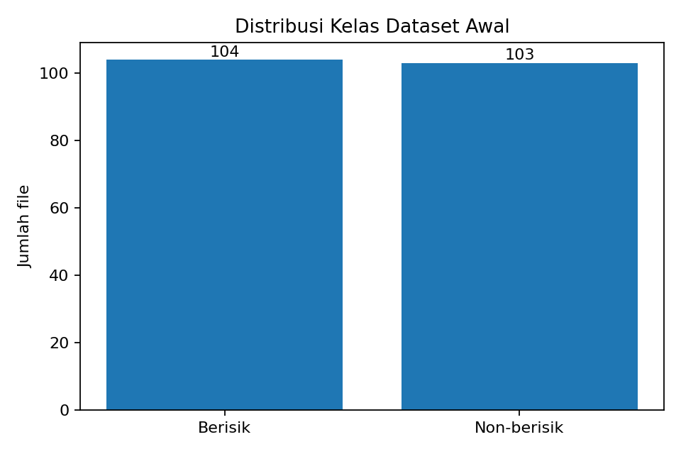
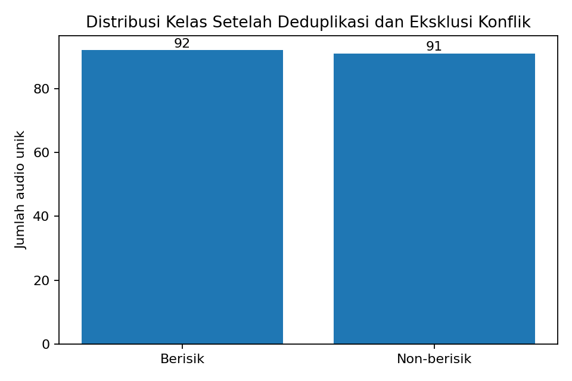
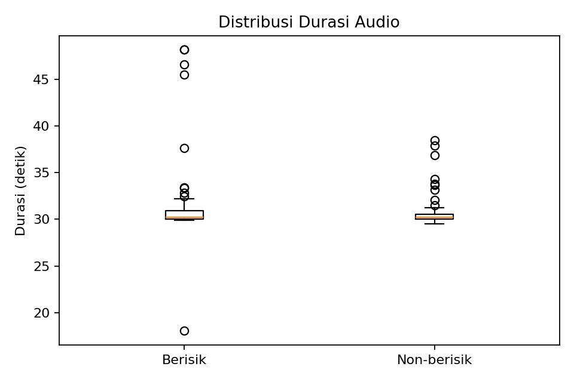
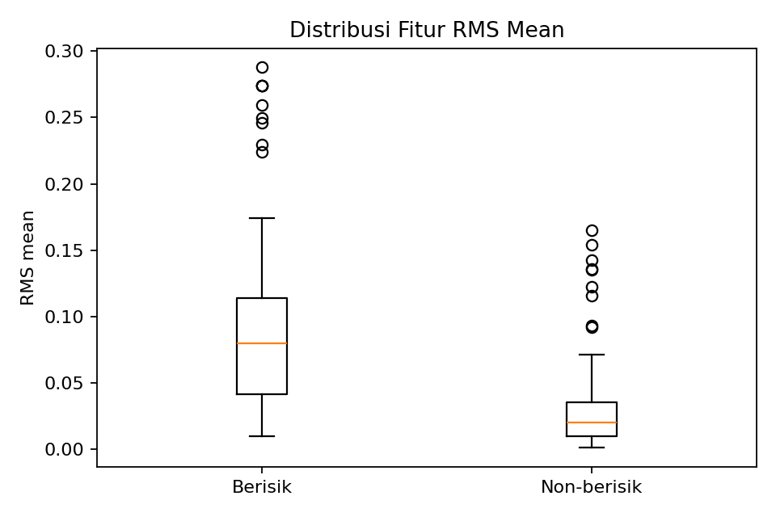
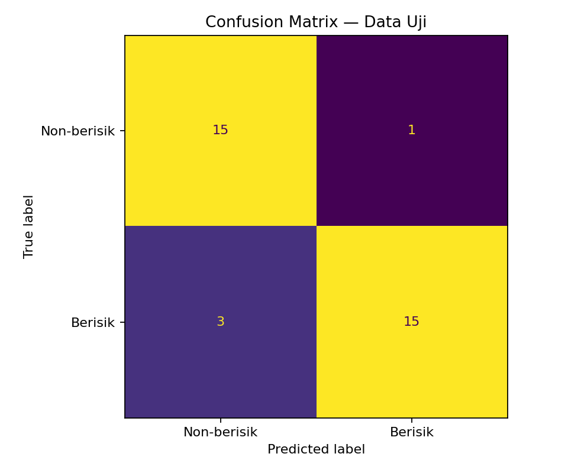
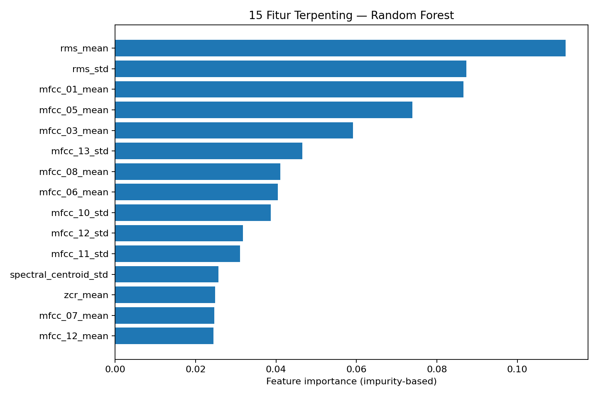

# LAPORAN PROYEK SAINS DATA

## Sistem Klasifikasi Audio Berisik dan Non-berisik menggunakan Ekstraksi Fitur Librosa dan Random Forest

**Mata kuliah:** Proyek Sains Data (PSD)  
**Anggota kelompok:** 4 orang — nama/NIM diisi oleh kelompok  
**Dataset:** Audio berisik dan non-berisik yang dibagikan melalui Google Drive kelas

---

## Ringkasan

Proyek ini membangun pipeline klasifikasi audio dua kelas dari tahap Business Understanding sampai Deployment dengan metodologi CRISP-DM. Audio diproses menjadi mono dengan sample rate 16 kHz, lalu direpresentasikan oleh 32 fitur akustik yang mencakup RMS, spectral centroid, zero-crossing rate, dan 13 koefisien MFCC beserta statistik mean dan standard deviation. Random Forest dilatih menggunakan data yang telah dideduplikasi. Pemisahan data dilakukan berdasarkan kelompok sumber rekaman agar rekaman dari sumber yang sama tidak tersebar ke data latih dan uji.

Dataset awal memuat 207 entri (104 berisik dan 103 non-berisik). Audit menemukan 18 kelompok konten identik yang melibatkan 41 entri serta satu hash yang memiliki label bertentangan. Setelah salinan identik dalam label yang sama dipertahankan satu wakilnya dan konflik lintas kelas dikeluarkan sementara, diperoleh 183 sampel unik: 92 berisik dan 91 non-berisik.

Dalam eksperimen ini, Random Forest dengan parameter hasil pencarian memberikan accuracy 88,24%, balanced accuracy 88,54%, dan macro F1 88,24% pada satu hold-out test set berisi 34 sampel. Nilai macro F1 rata-rata terbaik pada grouped cross-validation internal adalah 73,23%. Baseline mayoritas menghasilkan accuracy 47,06% pada test set yang sama. Angka uji ini adalah hasil awal, bukan jaminan generalisasi; label folder belum diverifikasi secara manual satu per satu.

## 1. Business Understanding

### 1.1 Latar belakang

Audio lingkungan dapat berbeda dari segi energi sinyal, distribusi frekuensi, dan karakteristik spektralnya. Pemeriksaan manual setiap rekaman membutuhkan waktu, sehingga proyek ini mengeksplorasi sistem yang memprediksi apakah audio termasuk kategori berisik atau non-berisik berdasarkan fitur akustik.

### 1.2 Rumusan masalah

Bagaimana membangun sistem yang mengklasifikasikan audio berisik dan non-berisik secara otomatis menggunakan ekstraksi fitur akustik dan algoritma Random Forest?

### 1.3 Tujuan

1. Memahami karakteristik dan kualitas dataset audio.
2. Menyiapkan audio dengan pipeline preprocessing yang konsisten.
3. Mengekstrak fitur akustik berdimensi tetap untuk setiap file.
4. Melatih dan mengevaluasi model Random Forest dengan prosedur pemisahan data yang mengurangi data leakage.
5. Menyediakan aplikasi yang mengakses mikrofon browser untuk mengklasifikasikan suara sekitar secara berkala.

### 1.4 Pengguna dan ruang lingkup

Pengguna utama adalah mahasiswa/penguji proyek yang ingin mencoba klasifikasi audio melalui aplikasi. Input deployment berupa stream mikrofon browser yang dianalisis dalam jendela audio bergulir; output berupa label prediksi dan skor model per kelas. Proyek ini merupakan prototipe akademik, bukan sistem pengukuran kebisingan tersertifikasi.

### 1.5 Definisi target dan kriteria keberhasilan

Target mengikuti label folder sumber (`berisik` dan `non_berisik`). Definisi semantik operasional kelas perlu disejajarkan dengan instruksi dosen dan cara dataset diberi label. Data live diklasifikasikan dalam jendela bergulir 10 detik secara default; window ini bukan validasi kebisingan terkalibrasi. Keberhasilan teknis dinilai melalui keberhasilan pipeline, tidak adanya kebocoran kelompok sumber dalam split, metrik per kelas, pembandingan dengan baseline, serta kemampuan aplikasi menerima dan mengklasifikasikan audio mikrofon langsung. Validitas prediksi live tetap membutuhkan uji terpisah pada kondisi nyata.

## 2. Data Understanding

### 2.1 Asal dan jumlah data

Dataset terdiri dari dua ZIP yang diberikan pengguna. Audit awal menemukan:

| Kelas | Jumlah entri awal |
|---|---:|
| Berisik | 104 |
| Non-berisik | 103 |
| **Total** | **207** |

Seluruh 207 entri berhasil didekode saat audit. Walau ekstensi file umumnya `.mp3`, pemeriksaan container menemukan 204 format terdeteksi sebagai MP3, dua AAC, dan satu container MOV/MP4 dengan codec AAC. Karena itu, pipeline perlu membaca konten file dan tidak hanya mengandalkan ekstensi.

Sample rate sumber tidak seragam: 129 file terdeteksi 48 kHz, 72 file 44,1 kHz, dan enam file 16 kHz. Sebanyak 147 file memiliki dua kanal dan 60 file satu kanal. Standardisasi audio dibutuhkan sebelum ekstraksi fitur.

### 2.2 Durasi

| Kelas | Minimum | Median | Rata-rata | Maksimum |
|---|---:|---:|---:|---:|
| Berisik | 18,039 detik | 30,216 detik | 31,135 detik | 48,170 detik |
| Non-berisik | 29,510 detik | 30,250 detik | 30,673 detik | 38,496 detik |

Mayoritas audio berdurasi sekitar 30 detik. Untuk eksperimen ini setiap file asli diperlakukan sebagai satu sampel. Audio tidak dipecah menjadi beberapa chunk karena durasi relatif pendek dan jumlah sampel independen terbatas.

### 2.3 Audit duplikasi dan konflik label

- Terdapat 184 hash unik dari 207 entri.
- Ada 18 kelompok duplikasi byte-identik, yang melibatkan 41 entri.
- Sebanyak 17 kelompok duplikat berada di kelas yang sama.
- Satu hash muncul pada dua label berbeda: `24-034 berisik 1.mp3` dan `24-034 non-berisik 1.mp3`.

Isi dari dua file konflik identik hingga tingkat byte sehingga metadata saja tidak dapat menentukan label yang benar. Kedua entri dikeluarkan sementara dari matriks modeling. Salinan identik di dalam kelas yang sama diwakili oleh satu entri deterministik agar satu konten tidak memperoleh bobot berlebih.

### 2.4 Visualisasi eksploratif

**Distribusi kelas awal**



**Distribusi setelah deduplikasi dan eksklusi konflik**



**Distribusi durasi**



## 3. Data Preparation

### 3.1 Pemeriksaan dan decoding

Semua file asli dipertahankan dalam `data/raw/`. Setiap file diberi fingerprint SHA-256, metadata, label folder, dan kode sumber yang diduga berasal dari nama file. Jika konten identik terkait dengan beberapa kode sumber, kode sumber tersebut digabung ke kelompok cross-validation yang sama untuk mengurangi kebocoran.

### 3.2 Standardisasi

Audio didekode sebagai sinyal mono dengan sample rate 16.000 Hz. Librosa digunakan sebagai jalur utama; FFmpeg digunakan sebagai fallback untuk format yang tidak terbaca oleh decoder utama. Tidak dilakukan normalisasi volume otomatis karena tingkat energi dapat menjadi informasi bagi klasifikasi berisik/non-berisik. Frame hening tidak dibuang otomatis karena keheningan/aktivitas latar juga berpotensi terkait dengan kelas.

### 3.3 Ekstraksi fitur

Satu file diubah menjadi vektor dengan 32 fitur numerik:

| Kelompok fitur | Agregasi | Jumlah |
|---|---|---:|
| RMS | Mean dan standard deviation | 2 |
| Spectral centroid | Mean dan standard deviation | 2 |
| Zero-crossing rate | Mean dan standard deviation | 2 |
| MFCC 1–13 | Mean dan standard deviation setiap koefisien | 26 |
| **Total** | | **32** |

Definisi ini mengikuti materi HackMD perkuliahan. Angka 40 pada contoh data dummy di materi tidak digunakan, karena fungsi ekstraksi yang dijelaskan menghasilkan 32 fitur.

**Distribusi RMS mean menurut label**



Fitur RMS membantu merepresentasikan energi, tetapi tidak cukup sebagai satu-satunya penentu kelas. Karena itu model menggunakan semua fitur yang disepakati pada metode.

### 3.4 Matriks modeling

Setelah satu wakil untuk setiap hash valid dipilih dan hash konflik dikeluarkan, jumlah sampel menjadi:

| Kelas | Sampel unik untuk modeling |
|---|---:|
| Berisik | 92 |
| Non-berisik | 91 |
| **Total** | **183** |

Tidak ada nilai fitur non-finite atau file gagal diekstrak pada proses yang dijalankan dalam lingkungan ini.

## 4. Modeling

### 4.1 Algoritma

Model utama adalah `RandomForestClassifier` dari scikit-learn. Random Forest menggabungkan beberapa pohon keputusan dan bekerja langsung pada vektor fitur numerik. Pendekatan ini sesuai dengan materi perkuliahan dan relatif ringan untuk dataset kecil.

### 4.2 Pemisahan data dan pencegahan data leakage

Data dibagi menggunakan `StratifiedGroupKFold` 5-fold. Fold pertama digunakan sebagai test set, sementara parameter model dipilih melalui 4-fold `StratifiedGroupKFold` pada data latih. Seluruh file dari grup sumber yang sama ditempatkan hanya di satu partisi.

| Partisi | Total | Berisik | Non-berisik | Grup sumber |
|---|---:|---:|---:|---:|
| Train | 149 | 74 | 75 | 21 |
| Test | 34 | 18 | 16 | 6 |
| **Overlap grup train/test** | **0** | | | |

Sampel dari sumber yang sama tidak tersebar antara train dan test berdasarkan kelompok yang dibangun saat audit.

### 4.3 Pencarian parameter

Pencarian grid mengevaluasi kombinasi:

- `n_estimators`: 200 atau 400
- `max_depth`: `None` atau 12
- `min_samples_leaf`: 1, 2, atau 4
- `max_features`: `sqrt` atau 0,7

Kriteria pemilihan model adalah macro F1 pada grouped cross-validation di dalam data latih. Parameter terbaik pada eksperimen ini adalah `n_estimators=200`, `max_depth=None`, `min_samples_leaf=4`, dan `max_features='sqrt'`.

## 5. Evaluation

### 5.1 Hasil pada held-out test set

| Metrik | Random Forest |
|---|---:|
| Accuracy | 88,24% |
| Balanced accuracy | 88,54% |
| Macro precision | 88,54% |
| Macro recall | 88,54% |
| Macro F1 | 88,24% |
| Best inner grouped-CV macro F1 | 73,23% |

### 5.2 Per kelas

| Kelas | Precision | Recall | F1-score | Support |
|---|---:|---:|---:|---:|
| Non-berisik | 83,33% | 93,75% | 88,24% | 16 |
| Berisik | 93,75% | 83,33% | 88,24% | 18 |

### 5.3 Confusion matrix

Urutan baris/kolom: Non-berisik, Berisik.

| Aktual \ Prediksi | Non-berisik | Berisik |
|---|---:|---:|
| Non-berisik | 15 | 1 |
| Berisik | 3 | 15 |



Model salah mengklasifikasikan satu audio non-berisik menjadi berisik dan tiga audio berisik menjadi non-berisik pada test set ini.

### 5.4 Pembanding baseline

Baseline `DummyClassifier(strategy='most_frequent')` menghasilkan accuracy 47,06%, balanced accuracy 50,00%, dan macro F1 32,00% pada test set yang sama. Random Forest lebih baik pada pembagian data uji ini.

### 5.5 Feature importance



Feature importance berbasis impurity menunjukkan fitur yang sering membantu pemisahan di dalam model, tetapi bukan bukti hubungan sebab-akibat. Kepentingan fitur juga dapat berubah dengan dataset dan parameter.

### 5.6 Interpretasi dan keterbatasan evaluasi

1. Test set hanya berisi 34 sampel dan enam grup sumber, sehingga metrik dapat berubah pada pembagian data lain.
2. Macro F1 inner cross-validation 73,23% lebih rendah dari macro F1 test 88,24%; ini menunjukkan hasil sensitif terhadap grup/sampel yang diuji.
3. Label folder belum dikonfirmasi semantik satu per satu. Evaluasi mengukur kesesuaian prediksi model terhadap label sumber, yang mungkin mengandung noise.
4. File dengan nama atau karakteristik yang tidak konsisten ditandai untuk pemeriksaan tambahan di `data/processed/duplicate_review.csv` dan `reports/test_predictions.csv`. Prediksi model tidak dipakai untuk mengubah label secara otomatis.
5. Dataset berasal dari sumber kelas tertentu dan belum mewakili seluruh lingkungan suara; pengujian pada lingkungan, perangkat, jarak mikrofon, dan tingkat kebisingan lain perlu dilakukan sebelum penggunaan nyata.

## 6. Deployment

### 6.1 Arsitektur deteksi suara sekitar

1. Pengguna membuka aplikasi Streamlit, menekan START, dan memberi izin akses mikrofon pada browser.
2. Stream audio dikirim melalui WebRTC dari browser ke proses Python yang menjalankan aplikasi.
3. Audio di-resample menjadi mono 16 kHz, kemudian disusun sebagai jendela bergulir (default 10 detik).
4. Fungsi ekstraksi yang sama menghasilkan 32 fitur: RMS (mean/std), spectral centroid (mean/std), ZCR (mean/std), dan MFCC 1–13 (mean/std).
5. Random Forest menghasilkan label `berisik` atau `non_berisik` dan skor model per kelas; hasil diperbarui berkala sampai pengguna menekan STOP.

Aplikasi ini tidak menyimpan stream audio ke file secara permanen. Jika dipublikasikan secara online, audio dikirim ke server hosting untuk dianalisis. Penggunaan mikrofon browser membutuhkan izin pengguna dan HTTPS dalam hosting publik; WebRTC juga mungkin memerlukan konfigurasi jaringan STUN/TURN. Versi lokal menggunakan URL localhost.

### 6.2 Menjalankan aplikasi

```bash
sudo pacman -S --needed ffmpeg python python-pip
python -m venv .venv
source .venv/bin/activate       # Bash/Zsh
# Fish: source .venv/bin/activate.fish
python -m pip install --upgrade pip
python -m pip install -r requirements.txt
streamlit run app.py
```

Buka URL localhost yang ditampilkan, tekan START, dan izinkan akses mikrofon. Tunggu jendela audio pertama terkumpul; ukuran default 10 detik. Tekan STOP untuk menghentikan deteksi.

### 6.3 Validasi dan keterbatasan deployment

Kode aplikasi disiapkan menggunakan Streamlit-WebRTC dan PyAV untuk menerima frame mikrofon. Dalam lingkungan pembuatan artefak ini, dependensi antarmuka tersebut tidak tersedia dan instalasi paket eksternal tidak dapat dikonfirmasi, sehingga koneksi mikrofon belum diuji end-to-end melalui browser. Fungsi fitur dan inferensi model tetap diuji di pipeline/CLI. Kelompok harus menjalankan `pip install -r requirements.txt` dan melakukan uji manual pada laptop sebelum demo.

Audio live menggunakan jendela 10 detik secara default, sedangkan dataset training berasal dari rekaman dengan durasi yang umumnya lebih panjang. Oleh karena itu, performa 88,24% pada data uji file tidak boleh diklaim sebagai akurasi live. Validasi khusus pada stream mikrofon dan beragam kondisi ruangan masih diperlukan. Aplikasi belum dipublikasikan ke hosting publik.

### 6.4 Uji fungsional sebelum presentasi

- Beri izin mikrofon, tekan START, dan pastikan hasil pertama muncul setelah jendela audio penuh.
- Uji di lingkungan relatif tenang dan lingkungan dengan suara latar yang lebih ramai.
- Pastikan hasil diperbarui, tombol STOP mengakhiri stream, dan tombol START dapat memulai kembali.
- Periksa pemilihan mikrofon browser dan uji pada perangkat yang akan digunakan untuk presentasi.
- Jelaskan bahwa skor model bukan probabilitas terkalibrasi dan aplikasi tidak mengukur dB.

## 7. Kesimpulan

Proyek menyusun pipeline end-to-end untuk klasifikasi audio berisik dan non-berisik dengan Librosa dan Random Forest. Audit menemukan duplikasi dan konflik label, kemudian menghasilkan 183 konten unik untuk pemodelan. Pipeline mengekstrak 32 fitur per sampel, menggunakan pemisahan berbasis grup sumber, dan mengintegrasikan model ke aplikasi Streamlit-WebRTC untuk deteksi suara sekitar melalui mikrofon browser.

Hasil held-out test menunjukkan accuracy 88,24%, sementara cross-validation internal terbaik memberikan macro F1 73,23%. Perbedaan ini harus ditafsirkan sebagai ketidakpastian akibat ukuran dataset dan variasi antargrup, bukan sebagai bukti performa universal. Sebelum mengklaim performa final, validasi semantik label terutama pada konflik/kandidat bermasalah masih diperlukan.

## 8. Rekomendasi lanjutan

1. Minta konfirmasi sumber/pengunggah untuk konflik label `24-034` jika dimungkinkan.
2. Tinjau sampel yang model screening-nya tidak sejalan dengan label sumber; jangan mengganti label otomatis.
3. Kumpulkan lebih banyak rekaman independen dan variasi kondisi rekaman.
4. Laporkan hasil beberapa pengulangan grouped cross-validation atau gunakan nested cross-validation bila ingin memilih parameter dan mengestimasi performa secara lebih stabil.
5. Jika sistem dipakai di luar demonstrasi kelas, tambahkan uji pengguna, dokumentasi lingkungan aplikasi, dan pemantauan performa.

## Referensi

1. Materi perkuliahan, [Klasifikasi Audio — HackMD](https://hackmd.io/@ProyekSaindData/HyOT-AfnMl).
2. Librosa, [MFCC feature extraction](https://librosa.org/doc/0.11.0/generated/librosa.feature.mfcc.html).
3. scikit-learn, [RandomForestClassifier](https://scikit-learn.org/stable/modules/generated/sklearn.ensemble.RandomForestClassifier.html).
4. scikit-learn, [StratifiedKFold dan strategi validasi](https://scikit-learn.org/stable/modules/generated/sklearn.model_selection.StratifiedKFold.html).
5. Streamlit-WebRTC, [dokumentasi dan contoh audio receiver](https://github.com/whitphx/streamlit-webrtc).
