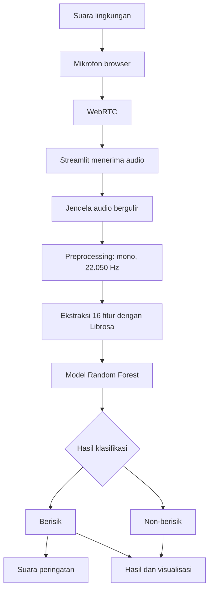

<div align="center">

# PSD Audio Detect

### Sistem Klasifikasi Suara Berisik dan Non-berisik Berbasis Mikrofon Langsung

<p>
  
  
  
  
  
</p>

**Kelompok 1 — Mata Kuliah Penambangan Sains Data (PSD-A)**

[Repository GitHub](https://github.com/GREED2308/PSD_Audio_detect)

</div>

---

## 📌 Tentang Proyek

**PSD Audio Detect** adalah aplikasi klasifikasi suara lingkungan yang menangkap audio secara langsung melalui mikrofon browser, kemudian mengklasifikasikannya menjadi dua kategori:

- **Berisik** — audio termasuk kategori berisik berdasarkan pola yang dipelajari dari dataset.
- **Non-berisik** — audio termasuk kategori non-berisik berdasarkan pola yang dipelajari dari dataset.

Aplikasi tidak mengharuskan pengguna mengunggah rekaman. Setelah pengguna memberikan izin mikrofon dan menekan tombol **START**, audio dikirim melalui WebRTC ke aplikasi Streamlit untuk dianalisis menggunakan ekstraksi fitur audio dan model **Random Forest**.

Proyek ini dibuat sebagai penerapan alur kerja sains data dari pemahaman dan persiapan data, pemodelan, evaluasi, hingga deployment menggunakan Docker.

## ✨ Fitur Aplikasi

| Fitur | Keterangan |
|---|---|
| 🎙️ Deteksi mikrofon langsung | Mengambil suara sekitar melalui mikrofon browser tanpa unggah file. |
| 📊 Visualisasi waveform dan equalizer | Menampilkan perubahan sinyal audio; visualisasi menjadi garis datar ketika sinyal berada di bawah ambang hening. |
| 🧠 Klasifikasi otomatis | Menghasilkan prediksi **Berisik** atau **Non-berisik** menggunakan Random Forest. |
| 🔊 Audio peringatan | Memutar suara peringatan ketika hasil prediksi berubah menjadi Berisik. |
| ⚙️ Pengaturan deteksi | Mengatur panjang jendela audio dan interval pembaruan prediksi. |
| 🐳 Docker Compose | Menjalankan aplikasi dalam container dengan satu port aplikasi yang dipublikasikan. |

> **Catatan:** klasifikasi merupakan estimasi berdasarkan pola dataset, bukan pengukuran tingkat kebisingan dalam satuan desibel (dB) dan bukan alat ukur kebisingan terkalibrasi.

## 🧭 Alur Kerja Sistem



### Tahapan pemrosesan

1. Pengguna membuka aplikasi dan memberikan izin akses mikrofon.
2. Pengguna menekan **START** pada komponen mikrofon.
3. Browser mengirimkan frame audio melalui WebRTC.
4. Aplikasi mengumpulkan audio dalam jendela waktu berjalan (*rolling window*).
5. Audio dikonversi menjadi mono dengan sample rate **22.050 Hz**.
6. Librosa mengekstraksi 16 fitur numerik.
7. Random Forest menghasilkan prediksi kelas.
8. Aplikasi menampilkan hasil, memperbarui visualisasi, dan memicu audio peringatan ketika transisi prediksi menuju kelas Berisik terjadi.

Panjang jendela audio dapat diatur pada aplikasi (default **10 detik**, rentang 5–15 detik). Interval pembaruan prediksi secara default **2 detik** dan dapat diubah pada sidebar.

## 🧪 Dataset

Dataset berasal dari kumpulan audio MP3 yang dibagikan untuk kelas PSD-A.

| Kategori | Jumlah awal |
|---|---:|
| Berisik | 100 file |
| Non-berisik | 100 file |
| **Total** | **200 file** |

### Audit dan pembersihan data

Sebelum pemodelan, dataset diperiksa menggunakan identitas konten (hash SHA-256) untuk menemukan file duplikat dan kemungkinan konflik label.

- Ditemukan kelompok konten duplikat.
- Salinan identik dalam kelas yang sama direpresentasikan oleh satu file.
- Konten identik yang muncul pada dua label berbeda dikeluarkan sementara sampai label sumber dapat dikonfirmasi.
- Setelah proses tersebut, dataset pemodelan berisi **176 sampel unik**, terdiri dari **88 berisik** dan **88 non-berisik**.

CSV fitur awal tetap disimpan sebagai dokumentasi. File yang digunakan untuk pemodelan adalah `data/features_model.csv`. Arsip MP3 mentah tidak disertakan dalam repository agar ukuran repository tetap terkendali.

## 🎚️ Ekstraksi Fitur Audio

Model menggunakan **16 fitur ringkasan (mean)** yang diekstraksi menggunakan Librosa.

| Kelompok fitur | Jumlah | Keterangan |
|---|---:|---|
| RMS (*Root Mean Square*) | 1 | Rata-rata energi/amplitudo sinyal audio. |
| Spectral Centroid | 1 | Rata-rata pusat spektral yang menggambarkan karakteristik kecerahan suara. |
| Zero Crossing Rate (ZCR) | 1 | Rata-rata tingkat perubahan tanda sinyal. |
| MFCC 1–13 | 13 | Rata-rata 13 koefisien Mel-Frequency Cepstral. |
| **Total** | **16** | Seluruh nilai menggunakan agregasi mean. |

Ekstraksi fitur pada saat training dan prediksi mikrofon menggunakan konfigurasi yang sama:

- Kanal audio: mono.
- Sample rate: **22.050 Hz**.
- Library: Librosa.
- Fitur: RMS mean, Spectral Centroid mean, ZCR mean, dan MFCC 1–13 mean.

Konsistensi urutan dan konfigurasi fitur diperlukan agar vektor masukan saat deployment sesuai dengan model hasil training.

## 🤖 Pemodelan dan Evaluasi

Algoritma klasifikasi yang digunakan adalah **Random Forest Classifier**.

| Konfigurasi | Nilai |
|---|---:|
| Algoritma | Random Forest Classifier |
| Jumlah decision tree (`n_estimators`) | **200** |
| Jumlah fitur masukan | **16** |
| Jumlah sampel pemodelan | **176** |
| Validasi | 5-fold StratifiedGroupKFold |
| Pengelompokan data | `source_student_id` |

Validasi menggunakan pengelompokan berdasarkan sumber/mahasiswa agar sampel dari sumber yang sama tidak tersebar ke fold pelatihan dan validasi.

### Hasil evaluasi

| Metrik | Hasil |
|---|---:|
| Accuracy out-of-fold | **75,57%** |
| Macro F1-score out-of-fold | **75,57%** |

Angka tersebut merupakan hasil prediksi *out-of-fold* dari validasi silang berkelompok 5-fold, bukan hasil dari satu test set eksternal yang sepenuhnya terpisah. Hasil mengukur kemampuan model mengikuti label dataset yang tersedia. Label sumber belum seluruhnya diverifikasi secara manual, sehingga performa pada kondisi lingkungan lain dapat berbeda.

Artefak evaluasi tersedia di folder `reports/`, antara lain hasil evaluasi, prediksi out-of-fold, pembagian fold, dan *feature importance*.

## 🛠️ Teknologi yang Digunakan

| Teknologi | Penggunaan |
|---|---|
| Python | Bahasa pemrograman utama. |
| Streamlit | Antarmuka aplikasi web. |
| Streamlit-WebRTC | Mengirim audio mikrofon browser ke aplikasi. |
| PyAV (`av`) | Pemrosesan dan resampling frame audio WebRTC. |
| Librosa | Preprocessing dan ekstraksi fitur audio. |
| NumPy & Pandas | Pengolahan data numerik dan tabel. |
| Scikit-learn | Random Forest dan evaluasi model. |
| Joblib | Menyimpan dan memuat model terlatih. |
| Docker | Membungkus aplikasi dan dependensinya ke dalam image. |
| Docker Compose | Menjalankan container dengan konfigurasi port dan layanan. |

## 📁 Struktur Repository

```text
PSD_Audio_detect/
├── app.py                         # Entry point aplikasi Streamlit
├── Dockerfile                     # Instruksi build Docker image
├── docker-compose.yml             # Konfigurasi container dan port
├── requirements.txt               # Dependensi Python
├── requerements.txt               # Nama alternatif sesuai instruksi tugas
├── prepare_dataset.py             # Pembersihan dataset dan duplikasi
├── train_model.py                 # Training dan evaluasi Random Forest
├── DOCKER_GUIDE.md                # Panduan Docker
├── LAPORAN_PSD.md                 # Dokumentasi tahapan proyek PSD
├── README_DEPLOYMENT.md           # Panduan deployment
│
├── assets/
│   └── jangan_berisik.mp3         # Audio peringatan
│
├── data/
│   ├── dataset_fitur_suara_original.csv
│   ├── dataset_manifest.csv
│   ├── duplicate_audit.csv
│   └── features_model.csv         # Dataset bersih untuk pemodelan
│
├── models/
│   ├── random_forest.joblib       # Model Random Forest terlatih
│   └── model_metadata.json        # Metadata model dan konfigurasi
│
├── notebooks/                     # Notebook eksperimen
├── reports/                       # Hasil evaluasi dan visualisasi
│
└── src/
    ├── audio_features.py          # Pipeline preprocessing dan fitur
    └── wave_visualizer.py         # Visualisasi waveform/equalizer
```

## 🚀 Menjalankan Aplikasi

Ada dua cara untuk menjalankan proyek: menggunakan Python secara lokal atau menggunakan Docker Compose. Untuk pengumpulan tugas, gunakan Docker Compose.

### Prasyarat

- Git.
- Python **3.13** untuk menjalankan secara lokal (versi yang digunakan pada Dockerfile).
- Docker Desktop dengan Docker Engine dan Docker Compose aktif untuk menjalankan container.
- Browser yang mendukung akses mikrofon dan WebRTC.

### 1. Clone repository

```bash
git clone https://github.com/GREED2308/PSD_Audio_detect.git
cd PSD_Audio_detect
```

### 2. Menjalankan secara lokal dengan Python

**Windows PowerShell:**

```powershell
py -m venv .venv
.\.venv\Scripts\Activate.ps1
python -m pip install --upgrade pip
python -m pip install -r requirements.txt
python -m streamlit run app.py
```

**Linux / macOS:**

```bash
python3 -m venv .venv
source .venv/bin/activate
python -m pip install --upgrade pip
python -m pip install -r requirements.txt
python -m streamlit run app.py
```

Buka alamat lokal yang ditampilkan Streamlit, biasanya:

```text
http://localhost:8501
```

Izinkan akses mikrofon pada browser, kemudian tekan **START**.

### 3. Menjalankan dengan Docker Compose

Pastikan Docker Desktop sudah berjalan. Semua perintah dijalankan dari direktori root repository (folder yang berisi `Dockerfile` dan `docker-compose.yml`).

Periksa konfigurasi Compose:

```bash
docker compose config
```

Build image dan jalankan container:

```bash
docker compose up --build -d
```

Periksa status container:

```bash
docker compose ps
```

Lihat log aplikasi:

```bash
docker compose logs -f
```

Buka aplikasi pada:

**http://localhost:8001**

Hentikan container:

```bash
docker compose down
```

### Konfigurasi port Kelompok 1

```yaml
ports:
  - "8001:8080"
```

- `8001` adalah port pada komputer host.
- `8080` adalah port aplikasi di dalam container.
- Port yang dibuka ke host hanya **8001**.

Jika port `8001` sedang digunakan aplikasi lain, hentikan aplikasi tersebut atau sesuaikan port host sesuai ketentuan dosen. Jangan mengubah port internal `8080` tanpa menyesuaikan konfigurasi aplikasi.

## 🎤 Penggunaan Aplikasi

1. Buka aplikasi melalui browser.
2. Buka pengaturan deteksi bila ingin mengubah panjang jendela audio atau interval prediksi.
3. Tekan **START** dan berikan izin akses mikrofon.
4. Tunggu sampai jendela audio pertama terkumpul.
5. Amati waveform/equalizer dan hasil klasifikasi yang diperbarui berkala.
6. Jika sistem mendeteksi transisi ke kelas **Berisik**, aplikasi dapat memutar audio peringatan jika fitur tersebut aktif.
7. Tekan **STOP** untuk menghentikan pengambilan audio.

Jika browser tidak memutar audio peringatan secara otomatis, gunakan kontrol pemutar audio atau tombol tes suara yang tersedia di aplikasi. Kebijakan autoplay browser dapat membatasi pemutaran otomatis.

## 🔐 Privasi dan Catatan Deployment

- Akses mikrofon hanya dimulai setelah pengguna menekan **START** dan memberikan izin browser.
- Frame audio dikirim melalui WebRTC ke proses Python yang menjalankan aplikasi untuk dianalisis.
- Aplikasi tidak menyimpan rekaman audio secara permanen ke disk.
- Jika aplikasi diakses dari domain/server selain `localhost`, gunakan **HTTPS** agar izin mikrofon dapat diberikan browser.
- Koneksi WebRTC dapat memerlukan konfigurasi STUN/TURN tambahan bergantung pada jaringan dan firewall.
- Pada deployment jarak jauh, audio diproses oleh server tempat aplikasi berjalan. Hindari mengirim audio sensitif ke server yang tidak dipercaya.

## ⚠️ Batasan Sistem

1. Model hanya membedakan dua kelas berdasarkan label dan karakteristik dataset yang digunakan.
2. Prediksi merupakan estimasi klasifikasi, bukan pengukuran tingkat kebisingan terkalibrasi.
3. Rekaman pelatihan umumnya berdurasi sekitar 30 detik, sedangkan audio live menggunakan jendela yang dapat lebih pendek. Perbedaan durasi dapat memengaruhi hasil prediksi.
4. Kualitas mikrofon, jarak sumber suara, kondisi ruangan, dan karakteristik perangkat dapat memengaruhi fitur audio.
5. Label dataset belum seluruhnya diverifikasi manual. Hasil evaluasi perlu dibaca dengan mempertimbangkan keterbatasan ini.
6. Jika jaringan tidak mendukung koneksi WebRTC secara langsung, konfigurasi TURN atau firewall mungkin diperlukan.

## 👥 Anggota Kelompok

| NIM | Nama |
|---|---|
| 24-100 | Verdi Setyawan Ardiansyah Putra |
| 24-125 | Triswanti Jannatul Ma'wa |
| 24-137 | Deo Candra Saputra |
| 24-123 | Alghifari Amar Mukhasyafah |

## 📚 Dokumentasi dan Referensi

- [Laporan Proyek PSD](LAPORAN_PSD.md)
- [Panduan Docker](DOCKER_GUIDE.md)
- [Panduan Deployment](README_DEPLOYMENT.md)
- [Dokumentasi Dockerfile](https://docs.docker.com/reference/dockerfile/)
- [Dokumentasi Docker Compose](https://docs.docker.com/compose/)
- [Dokumentasi Streamlit](https://docs.streamlit.io/)
- [Streamlit-WebRTC](https://github.com/whitphx/streamlit-webrtc)
- [Dokumentasi Librosa](https://librosa.org/doc/latest/index.html)
- [Dokumentasi Scikit-learn](https://scikit-learn.org/stable/)

---

<div align="center">

**PSD Audio Detect — Kelompok 1 PSD-A**  
Dibuat untuk memenuhi tugas proyek mata kuliah Penambangan Sains Data.

</div>
